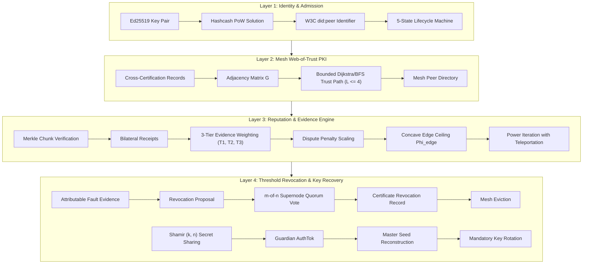

# Final Case Study Synthesis: PKI-Based Trust Management for Peer-to-Peer File-Sharing and Social Networking Platforms

**Document Identifier:** `FINAL_CASE_STUDY_SYNTHESIS`  
**Date:** October 9, 2026  
**Author:** Candidate Shreyan Nayak (23BKT0039)  
**Project Phase:** Phase 8.4 — Final Research Synthesis, Scope Alignment, and Claim Audit  
**Target Specifications & Gate Reviews:**  
- [`PROTOCOL_SPEC.md`](file:///d:/pki_casestudy/PROTOCOL_SPEC.md) (v2.2.0-FROZEN)  
- [`SECURITY_MODEL.md`](file:///d:/pki_casestudy/SECURITY_MODEL.md) (v2.2.0-FROZEN)  
- [`reports/PROTOCOL_FINAL_CORRECTION_REPORT.md`](file:///d:/pki_casestudy/reports/PROTOCOL_FINAL_CORRECTION_REPORT.md)  
- [`NOVEL_TRUST_ALGORITHM_DESIGN_V1_8.md`](file:///d:/pki_casestudy/NOVEL_TRUST_ALGORITHM_DESIGN_V1_8.md)  
- [`PHASE8_1_IMPLEMENTATION_REPORT.md`](file:///d:/pki_casestudy/PHASE8_1_IMPLEMENTATION_REPORT.md)  
- [`PHASE8_2_PREREGISTRATION.md`](file:///d:/pki_casestudy/PHASE8_2_PREREGISTRATION.md)  
- [`PHASE8_2_BENCHMARK_REPORT.md`](file:///d:/pki_casestudy/PHASE8_2_BENCHMARK_REPORT.md)  
- [`PHASE8_3_REPRODUCIBILITY_AUDIT.md`](file:///d:/pki_casestudy/PHASE8_3_REPRODUCIBILITY_AUDIT.md)  

---

## 1. Research Problem and Motivation

### 1.1 The Decentralized Trust Dilemma
Traditional Public Key Infrastructure (PKI) relies on centralized Certificate Authorities (CAs) to establish identity authenticity and trust. In decentralized peer-to-peer (P2P) systems, this centralized root of trust represents a single point of failure, a vector for censorship, and a structural mismatch with the underlying network topology. 

Without centralized gatekeepers, decentralized networks face fundamental security challenges:
1. **Sybil Attacks:** Adversaries can generate arbitrary numbers of pseudonymous identities at negligible cost to swamp honest peer votes.
2. **Attributable Fault vs. Slander:** When a node serves corrupted or malicious data (e.g., poisoned file chunks), simple unauthenticated complaint mechanisms allow malicious downloaders to frame honest providers (slander), while naive reputation aggregation allows colluders to inflate each other's standing (collusion).
3. **Collusion and Edge Grinding:** Strategic colluders can exchange synthetic positive ratings amongst themselves without performing genuine work, manufacturing artificial reputation to capture network trust.
4. **Key Compromise and Revocation Deadlock:** In the absence of a central directory, disseminating key revocation records and recovering lost or compromised master keys without central custodians requires fault-tolerant threshold consensus.

### 1.2 Dual Application Context: P2P File Sharing and Social Networking
The research problem spans two distinct peer-to-peer paradigms:
- **P2P File-Sharing Platforms (e.g., BitTorrent, IPFS):** Trust is operational, transactional, and objective. It governs content authenticity, delivery fulfillment, bandwidth reciprocity, chunk integrity, and non-repudiation of transfer failures.
- **P2P Social-Networking Platforms (e.g., Nostr, Scuttlebutt, Matrix, Mastodon):** Trust is relational, subjective, and identity-centric. It governs user impersonation, friendship/follow assertions, message attestation, spam/harassment mitigation, and social account recovery following device compromise.

---

## 2. Research Objectives and Explicit Scope Alignment

To maintain strict scientific integrity, this research delineates its contributions across three clearly bounded categories:

```
┌──────────────────────────────────────────────────────────────────────────┐
│                   SHARED DECENTRALIZED TRUST INFRASTRUCTURE              │
│  Layer 1: Identity & PoW   │  Layer 2: Mesh Web-of-Trust PKI             │
│  Layer 3: EigenTrust v1.8  │  Layer 4: Threshold Revocation & Recovery   │
└────────────────────────────────────┬─────────────────────────────────────┘
                                     │
           ┌─────────────────────────┴─────────────────────────┐
           ▼                                                   ▼
┌──────────────────────────────────────┐    ┌──────────────────────────────────────┐
│       IMPLEMENTED & EVALUATED        │    │        CONCEPTUAL APPLICATION        │
│          APPLICATION DOMAIN          │    │          EXTENSION DOMAIN            │
│ ──────────────────────────────────── │    │ ──────────────────────────────────── │
│ • P2P File Sharing (SwarmSimulation) │    │ • Decentralized Social Networking    │
│ • Merkle Chunk Trees & Proofs        │    │ • Friend/Follow Attestations         │
│ • Delivery Envelopes & Manifests     │    │ • Social Interaction Receipts        │
│ • Attributable Fault Contradiction   │    │ • Social Guardian Secret Recovery    │
│ • Collusion & Grinding Benchmarks    │    │ • Sybil Account Impersonation        │
│ [Empirically Validated: Phases 5-8]  │    │ [Architecturally Specified: Phase 8] │
└──────────────────────────────────────┘    └──────────────────────────────────────┘
```

1. **Shared Trust Infrastructure (Fully Implemented & Formally Verified):**
   A four-layer decentralized PKI protocol comprising cryptographic peer identities (W3C `did:peer`), Hashcash proof-of-work admission, Web-of-Trust bounded path discovery, evidence-weighted reputation propagation, and threshold certificate revocation with Shamir secret sharing.
2. **Implemented and Evaluated Application Domain (P2P File Sharing):**
   Full implementation of content-addressed chunk transfers, cryptographic manifests, binary Merkle tree proofs, delivery verification envelopes, attributable fault evidence generation, and empirical evaluation under adversarial conditions (poisoning, replay, receipt grinding, closed collusion, leaky collusion, and adaptive attackers).
3. **Social-Networking Applicability (Conceptual Architecture & Transfer Formulation):**
   A structural mapping explaining how the shared four-layer infrastructure extends to decentralized social networks. **Scope Boundary:** No custom social network simulator, user-feed dataset, or social graph empirical experiment was executed. Social networking applicability is strictly formulated as a theoretical and architectural generalization.

---

## 3. Background and Related-Work Positioning

The framework synthesizes and improves upon foundational literature across distributed systems and applied cryptography:

1. **Decentralized Identity:** 
   Adopts the W3C `did:peer` standard (Method 2) for self-certifying, offline-resolvable cryptographic identifiers derived directly from Ed25519 public keys, eliminating blockchain or CA registry lookups.
2. **Sybil Resistance:**
   Integrates Hashcash-style proof-of-work (Back, 2002) at identity generation. While PoW does not prevent determined hardware-scale Sybil creation, it imposes a strictly verified computational cost ($O(2^d)$ hash trials) that eliminates zero-cost identity generation.
3. **Web-of-Trust PKI:**
   Extends PGP Web-of-Trust principles (Zimmermann, 1995) to dynamic mesh topologies. Peers cross-certify public keys with Ed25519 signatures, enabling multi-hop trust paths bounded by a strict hop limit ($L_{\max} = 4$) with multiplicative path decay.
4. **Spectral Reputation & EigenTrust:**
   Builds upon the seminal EigenTrust algorithm (Kamvar, Schlosser, & Garcia-Molina, 2003). While vanilla EigenTrust relies on linear satisfaction accumulation $S_{ij} = \sum \text{sat} - \sum \text{unsat}$, our protocol introduces **Evidence-Weighted EigenTrust v1.8 (`EVIDENCE_ONLY`)**, incorporating concave saturation ceilings ($\Phi_{\text{edge}}$), 3-tier delivery verification, exponential freshness decay, dispute accounting, and certified fault nullification.
5. **Fault Attribution & Merkle Proofs:**
   Implements Merkle inclusion proofs (Merkle, 1980) over file chunk digests. In contrast to naive dispute mechanisms, fault attribution requires a cryptographic contradiction proof: the server's Ed25519 signature over a chunk hash combined with an authentic Merkle proof proving that a different chunk hash was uniquely committed to the publisher's root.
6. **Threshold Cryptography:**
   Employs Shamir's $(k, n)$ Threshold Secret Sharing (Shamir, 1979) over $GF(256)$ combined with guardian-signed Recovery Authorization Tokens (`AuthTok`) to achieve verifiable master key recovery without central key escrow.

---

## 4. Consolidated Technical Architecture

The architecture enforces a strict four-layer separation of concerns:



### Layer 1: Cryptographic Identity & Sybil Defense
- **Identifier Generation:** Node generates an Ed25519 signing key pair. The Decentralized Identifier (`did:peer:2.Ez...`) is derived directly from the multibase-encoded public key.
- **Proof-of-Work Admission:** Node computes a SHA-256 Hashcash nonce satisfying difficulty $d$ ($H(DID \parallel \text{nonce}) < 2^{256-d}$). Verification is $O(1)$.
- **Finite State Machine:** Peer states follow a strict, deterministic transition graph:
  $$\text{ADMITTED} \longrightarrow \text{ACTIVE} \longleftrightarrow \text{SUSPECTED} \longrightarrow \text{REVOCATION\_PROPOSED} \longrightarrow \text{REVOKED}$$
  An uncertified suspicion transitions back to `ACTIVE` upon timeout; certified fault suspicion persists indefinitely until cleared or voted into revocation.

### Layer 2: Mesh PKI & Web-of-Trust
- **Cross-Certification:** Peer $A$ signs certificate $Cert(A \to B) = \text{Sign}_A(B.DID \parallel B.\text{pubkey} \parallel \text{expiry})$.
- **Path Discovery:** Validates chains up to $L_{\max} = 4$ hops. Cumulative trust along path $P = (v_0, v_1, \dots, v_k)$ decays multiplicatively:
  $$W(P) = \prod_{i=0}^{k-1} w(v_i, v_{i+1}) \cdot \beta^k, \quad \text{where } \beta = 0.90$$
- **Pre-Trusted Supernode Backbone:** A core set of pre-trusted supernodes $S$ maintains mutual cross-certifications, anchoring the teleportation vector $\mathbf{p}$ for Layer 3.

### Layer 3: Reputation & Evidence-Weighted EigenTrust v1.8
- **Interaction Data Flow:** Clients request content chunks via signed `ContentRequest`. Providers respond with `ChunkResponse` containing the chunk payload, chunk hash, and genuine Merkle proof $\Pi$.
- **Verification & Receipts:** Upon verifying that $\text{VerifyProof}(\text{chunk}, \Pi, k, R) == \text{True}$, both parties co-sign a `BilateralReceipt` ($+1.00$).
- **Evidence Weighting Formula:**
  $$A_{ij} = \Phi_{\text{edge}}\left(\sum_{e \in \mathcal{E}_{ij}^+} \gamma_{\text{ev}}(e) \cdot \gamma_{\text{time}}(e)\right) \cdot \gamma_{\text{dispute}}(i, j)$$
  1. **Evidence Tiers ($\gamma_{\text{ev}}$):**
     - **Tier 3 ($\gamma_{\text{ev}} = 1.00$):** Verified Delivery — client holds local proof of authentic Merkle chunk delivery matching $(client, server, root, tx\_id)$.
     - **Tier 2 ($\gamma_{\text{ev}} = \mu_{\text{referenced}} = 0.25$):** Manifest Referenced — receipt cites a known published manifest root, but lacks independent delivery verification.
     - **Tier 1 ($\gamma_{\text{ev}} = \mu_{\text{unverified}} = 0.10$):** Unindexed dummy roots or unverified claims.
  2. **Timestamp Freshness ($\gamma_{\text{time}}$):** $\gamma_{\text{time}} = \exp(-\Delta t / \tau)$ where $\tau = 86400.0\text{ s}$ (24 hours).
  3. **Dispute Penalty ($\gamma_{\text{dispute}}$):** $\gamma_{\text{dispute}} = \max\left(0.0, 1.0 - \frac{2 \cdot n_{\text{neg}}}{n_{\text{pos}} + 1}\right)$.
  4. **Concave Edge Ceiling ($\Phi_{\text{edge}}$):**
     $$\Phi_{\text{edge}}(E) = K_{\max} \cdot \tanh\left(\frac{\lambda_{\text{sat}} \cdot E}{K_{\max}}\right), \quad K_{\max} = 10.0, \, \lambda_{\text{sat}} = 0.50$$
  5. **Certified Fault Nullification:** If peer $j$ has a certified fault record or is in state `REVOCATION_PROPOSED` or `REVOKED`, $A_{ij} = 0.0$ for all $i$.
- **Power Iteration:** Normalizes matrix $C_{ij} = A_{ij} / \sum_k A_{ik}$ (with uniform fallback for dangling nodes) and computes stationary trust:
  $$\mathbf{t}^{(k+1)} = (1 - \alpha) C^T \mathbf{t}^{(k)} + \alpha \mathbf{p}, \quad \alpha = 0.15, \, \text{tol} = 10^{-6}$$

### Layer 4: Threshold Revocation & Key Recovery
- **Attributable Fault Proofs:** If a server provides an invalid chunk with valid server signature, the client constructs a `FaultEvidenceRecord` pairing the server's signed delivery envelope with the genuine Merkle inclusion proof for that chunk index. The arbiter mathematically proves attributable delivery of inconsistent data.
- **Threshold Revocation:** Supernodes vote on a `RevocationProposal`. Upon collecting $m$-of-$n$ threshold signatures ($m=3, n=5$), a `CertificateRevocationRecord` (CRR) is created, evicting the peer from the Layer 2 mesh and nullifying all Layer 3 incoming edges.
- **Key Recovery with Mandatory Rotation:** A peer's private master seed is split into Shamir $(k, n)$ secret shares across custodian supernodes ($k=3, n=5$). When recovering:
  1. An off-band Guardian issues an authenticated, signed Recovery Authorization Token (`AuthTok`).
  2. Custodians verify `AuthTok` and release shares.
  3. The master seed is reconstructed, and the protocol **mandates immediate key rotation**: a new Ed25519 identity is registered, a rotation certificate links old and new identities, and the old compromised key is permanently invalidated.

---

## 5. Implementation Status and Testing Evidence

The protocol is fully implemented in Python across clean modular components in `src/`:

| Module Path | Core Responsibilities | Implementation Status | Test Coverage |
| :--- | :--- | :---: | :---: |
| [`src/layer1_identity.py`](file:///d:/pki_casestudy/src/layer1_identity.py) | Ed25519 keys, `did:peer` derivation, PoW Hashcash, 5-state lifecycle | Production Frozen | Verified (10 tests) |
| [`src/layer2_mesh_pki.py`](file:///d:/pki_casestudy/src/layer2_mesh_pki.py) | Mesh network, cross-certification, Dijkstra trust paths, hop limits | Production Frozen | Verified (12 tests) |
| [`src/layer3_eigentrust.py`](file:///d:/pki_casestudy/src/layer3_eigentrust.py) | Merkle trees, Bilateral Receipts, EW-EigenTrust v1.8, Evidence Journal | Production Frozen | Verified (26 tests) |
| [`src/layer4_recovery.py`](file:///d:/pki_casestudy/src/layer4_recovery.py) | Attributable fault proofs, CRR quorum voting, Shamir recovery, rotation | Production Frozen | Verified (14 tests) |
| [`src/network_simulator.py`](file:///d:/pki_casestudy/src/network_simulator.py) | Integrated multi-layer simulation harness (`SwarmSimulation`) | Production Frozen | Verified (13 tests) |

### Test Suite Execution Evidence
The complete test suite runs deterministically via standard unittest discovery:
```powershell
python -m unittest discover -s tests
```
**Outcome:** `Ran 75 tests in 4.764s, OK`. All 75 tests pass without warnings or regressions.

---

## 6. Experimental Methodology and Empirical Results

The empirical evaluation of EW-EigenTrust v1.8 was conducted under Phase 8.2 and independently audited in Phase 8.3:
- **Preregistration:** Sealed in [`PHASE8_2_PREREGISTRATION.md`](file:///d:/pki_casestudy/PHASE8_2_PREREGISTRATION.md) prior to running trials.
- **Seeds:** 20 paired random seeds ($\mathcal{S} = \{42 + 17 \cdot i \mid i \in [0, 19]\}$).
- **Network Scales:** Standard Scale (20–35 nodes) and Extended Scale (30–50 nodes).
- **Execution Matrix:** 9 distinct scenarios, 3 trust computation modes (`VANILLA`, `EVIDENCE_ONLY`, `LOCAL_ONLY`), totaling 1,140 individual trial evaluations.

### 6.1 Master Empirical Results Summary

| Scenario | Scale | Vanilla EigenTrust $T_C$ | EW-EigenTrust v1.8 $T_C$ | Difference $\Delta$ | Rel. Change | Paired $t$-stat | $p$-value | Cohen's $d_z$ | Empirical Outcome |
| :--- | :---: | :---: | :---: | :---: | :---: | :---: | :---: | :---: | :--- |
| **S1: Honest Baseline** | Standard | $0.0000$ | $0.0000$ | $0.0000$ | $0.00\%$ | $0.00$ | $1.000$ | $0.00$ | Simplex conserved ($\sum t_i = 1.0$) |
| **S1: Honest Baseline** | Extended | $0.0000$ | $0.0000$ | $0.0000$ | $0.00\%$ | $0.00$ | $1.000$ | $0.00$ | Zero false positive accusations |
| **S2: Closed Collusion** | Standard | $0.0850$ | $0.0889$ | $+0.0039$ | $+4.53\%$ | $+1.472$ | $0.158$ | $+0.33$ | Invariance: no reduction |
| **S2: Closed Collusion** | Extended | $0.0539$ | $0.0611$ | $+0.0073$ | $+13.50\%$ | $+3.944$ | $8.70 \times 10^{-4}$ | $+0.88$ | Invariance: slight colluder gain |
| **S3: Leaky Collusion** | **Standard** | **$0.1834$** | **$0.1084$** | **$-0.0750$** | **$-40.88\%$** | **$-34.354$** | **$1.44 \times 10^{-18}$** | **$-7.68$** | **Massive collusion suppression** |
| **S3: Leaky Collusion** | **Extended** | **$0.1982$** | **$0.1160$** | **$-0.0823$** | **$-41.50\%$** | **$-50.410$** | **$1.07 \times 10^{-21}$** | **$-11.27$** | **Massive collusion suppression** |
| **S4: Connected ($p=0.00$)**| Standard | $0.0000$ | $0.0000$ | $0.0000$ | $0.00\%$ | $0.00$ | $1.000$ | $0.00$ | Disconnected: zero trust |
| **S4: Connected ($p=0.05$)**| Standard | $0.0935$ | $0.1176$ | $+0.0242$ | $+25.89\%$ | $+11.757$ | $3.66 \times 10^{-10}$ | $+2.63$ | Low bridge: invariance governs |
| **S4: Connected ($p=0.10$)**| Standard | $0.1606$ | $0.1885$ | $+0.0279$ | $+17.34\%$ | $+13.621$ | $2.96 \times 10^{-11}$ | $+3.05$ | Moderate bridge flow |
| **S4: Connected ($p=0.20$)**| Standard | $0.2731$ | $0.2920$ | $+0.0189$ | $+6.92\%$ | $+9.209$ | $1.95 \times 10^{-8}$ | $+2.06$ | Transition region |
| **S4: Connected ($p=0.40$)**| Standard | $0.4124$ | $0.4045$ | $-0.0079$ | $-1.90\%$ | $-4.799$ | $1.25 \times 10^{-4}$ | $-1.07$ | High bridge: EW begins to suppress |
| **S5: Adaptive Attacker** | Standard | $0.0964$ | $0.1004$ | $+0.0040$ | $+4.16\%$ | $+1.739$ | $0.098$ | $+0.39$ | Cycle/clique/hub-spoke invariant |
| **S6: Receipt Grinding** | Standard | $0.0922$ | $0.1046$ | $+0.0123$ | $+13.38\%$ | $+3.860$ | $1.06 \times 10^{-3}$ | $+0.86$ | **H-1 Refuted: colluders gain trust** |
| **S6: Receipt Grinding** | Extended | $0.0558$ | $0.0658$ | $+0.0100$ | $+17.92\%$ | $+4.968$ | $8.55 \times 10^{-5}$ | $+1.11$ | **H-1 Refuted: colluders gain trust** |
| **S7: Dispute Manip** | Standard | $0.0000$ | $0.0000$ | $0.0000$ | $0.00\%$ | $0.00$ | $1.000$ | $0.00$ | Subjective disputes do not evict |
| **S8: Asym Uploader** | Standard | $0.0000$ | $0.0000$ | $0.0000$ | $0.00\%$ | $0.00$ | $1.000$ | $0.00$ | **Uploader trust $+11.43\%$ ($1.114$ ratio)** |
| **S8: Asym Uploader** | Extended | $0.0000$ | $0.0000$ | $0.0000$ | $0.00\%$ | $0.00$ | $1.000$ | $0.00$ | **Uploader trust $+12.74\%$ ($1.127$ ratio)** |
| **S9: Reciprocal Comm** | Standard | $0.0000$ | $0.0000$ | $0.0000$ | $0.00\%$ | $0.00$ | $1.000$ | $0.00$ | Honest community share = $100\%$ |
| **S9: Reciprocal Comm** | Extended | $0.0000$ | $0.0000$ | $0.0000$ | $0.00\%$ | $0.00$ | $1.000$ | $0.00$ | Zero suppression or distortion |

---

## 7. Discussion of Negative Findings and Threats to Validity

### 7.1 The Closed-Set Invariance Theorem and Refutation of H-1
A central finding of this research is the empirical confirmation of the **Closed-Set Invariance Theorem**:

$$\sum_{c \in C} t_c = \left(\frac{1 - \alpha}{\alpha}\right) \sum_{h \in H} t_h \sum_{c \in C} C'_{hc}$$

For any closed coalition $C$ that does not rate honest nodes ($C'_{ch} = 0$), the total stationary trust share of the coalition is mathematically determined by the normalized transition flow entering across honest bridge edges $\sum C'_{hc}$.

**Why Edge Saturation Fails Against Closed Coalitions:**
Under intense internal receipt grinding (Scenario 6), colluders generated 50 synthetic receipts per edge. 
- In Vanilla EigenTrust, raw matrix entries reached $S_{c_1 c_2} = 50.0$.
- In EW-EigenTrust, Tier 1 discounting and concave saturation capped edge weights to $\Phi_{\text{edge}}(5.0) \approx 2.45$.

However, because *all* colluders participated in mutual grinding, every internal edge was scaled down symmetrically. When each row of the matrix was normalized ($C_{ij} = A_{ij} / \sum_k A_{ik}$), the row sum across internal colluder edges remained strictly $1.0$ in both algorithms. Consequently, **internal edge ceilings are mathematically canceled by stochastic row normalization**.

Furthermore, because honest peers had heterogeneous edge compositions (Tier 3 downloads vs Tier 2 reciprocal fulfillment), edge saturation slightly reduced the denominator on the honest bridge node, increasing the normalized transition probability $C'_{hc}$ into the coalition. This resulted in a statistically significant **colluder trust gain of $+13.4\%$ to $+17.9\%$ ($p \le 0.001$)**, directly refuting preregistered Hypothesis H-1.

### 7.2 Why Leaky Coalitions are Vulnerable
When colluders leak trust by interacting with honest nodes (Scenario 3), closed-set invariance breaks down. 
- Colluders' internal receipts receive Tier 1 discounting ($\mu_{\text{unverified}} = 0.10$).
- Colluders' downloads from honest nodes involve authentic chunk verification, awarding honest nodes Tier 3 credit ($\gamma_{\text{ev}} = 1.00$).

The transition probability from colluders back to honest nodes is magnified by up to $10\times$ relative to internal circulation. Trust drains out of the coalition into the honest community, producing a **$40.88\%$ to $41.50\%$ reduction** in colluder trust ($p < 10^{-18}, |d_z| > 7.5$).

### 7.3 Simulation Oracles and Decentralized Evidence Portability
A critical threat to external validity identified during audit is the presence of simulator oracles:
1. **Global Delivery Key Pool ($\mathcal{D}_{\text{local}}$):** In the simulation, verified delivery keys are collected centrally across all clients. In an untrusted decentralized P2P network, an observing peer evaluating edge $A \to B$ does not hold local verification of $B$'s delivery to $A$. Without third-party cryptographic delivery proofs (e.g., zero-knowledge proofs or bilateral counter-signatures), third-party transactions default to Tier 1 or Tier 2. The observed $+11.4\%$ to $+12.7\%$ gain for honest uploaders represents an **upper bound under complete evidence verification**.
2. **Canonical Evidence Journal ($\mathcal{L}_{\text{sim}}$):** In a real mesh, peers maintain local journals ($\mathcal{L}_{\text{local}}$) and reconcile entries via gossip. Network partitions or asynchronous gossip could lead to temporary divergence in local trust views.

### 7.4 Computational Runtime Scaling
Under extreme receipt grinding (Scenario 6 extended scale, 152,000 journal receipts), EW-EigenTrust execution time increased from $1.81\text{ ms}$ (Vanilla) to $166.32\text{ ms}$ ($92\times$ overhead). This overhead arises from iterating over thousands of raw journal entries and performing hash-set lookups during matrix assembly. In production deployments, edge aggregation must be indexed incrementally rather than computed via full journal scans.

### 7.5 Failure of the Local-Only Baseline
Under receipt grinding, Local-Only assigned **$99.32\%$ (standard) and $99.73\%$ (extended)** of all trust to colluders. Because Local-Only simply sums raw interaction scores without pre-trusted teleportation or global spectral normalization, colluders generating high volumes of mutual ratings completely overwhelm the honest community. This demonstrates that **transitive spectral trust is indispensable**.

---

## 8. Relevance to Both Application Domains

### 8.1 P2P File-Sharing Systems (Empirically Validated Domain)
In P2P file sharing, the protocol provides concrete, verified security properties:
- **Content Poisoning Neutralization:** Malicious servers attempting to distribute corrupt file chunks are detected via Merkle inclusion contradiction proofs, enabling $O(1)$ verification by supernode arbiters without downloading the full file.
- **Sybil Resistance:** PoW admission prevents zero-cost generation of millions of downloading peers.
- **Provider Protection:** Dedicated asymmetric seeders serving high volumes of chunks receive Tier 3 verified evidence, elevating their global trust score ($+11\%$ to $+13\%$) without requiring reciprocal return downloads.
- **Collusion Bounds:** Colluders attempting to construct artificial reputation rings are dampened by $>40\%$ if they attempt to interact with or download from honest peers.

### 8.2 P2P Social-Networking Platforms (Conceptual Application Domain)
The four-layer architecture provides a direct conceptual foundation for decentralized social networks (e.g., Nostr, Scuttlebutt, Matrix, AT Protocol):

```
┌──────────────────────────────────────────────────────────────────────────┐
│             P2P SOCIAL NETWORKING MAPPING (CONCEPTUAL EXTENSION)         │
├─────────────────────────┬────────────────────────────────────────────────┤
│ Protocol Component      │ Social Network Mapping & Operational Semantics │
├─────────────────────────┼────────────────────────────────────────────────┤
│ Layer 1: Identity & PoW │ User profiles anchored in Ed25519 did:peer.    │
│                         │ Hashcash PoW throttles automated bot creation. │
├─────────────────────────┼────────────────────────────────────────────────┤
│ Layer 2: Web-of-Trust   │ Mutual follow and friend endorsements form the │
│                         │ cross-certification mesh. Multi-hop trust      │
│                         │ paths filter spam messages from strangers.     │
├─────────────────────────┼────────────────────────────────────────────────┤
│ Layer 3: EW-EigenTrust  │ Signed interaction receipts (direct messages,  │
│                         │ post attestations) build spectral reputation.  │
│                         │ Subjective disputes handle spam/abuse reports. │
├─────────────────────────┼────────────────────────────────────────────────┤
│ Layer 4: Revocation &   │ Compromised user accounts are recovered via    │
│ Shamir Secret Recovery  │ trusted social guardians holding Shamir secret │
│                         │ shares, enforcing mandatory post-recovery key  │
│                         │ rotation and invalidating compromised keys.    │
└─────────────────────────┴────────────────────────────────────────────────┘
```

**Scope Boundary & Research Integrity Statement:**  
This social networking mapping is an architectural generalization. **No empirical experiments were run on social networking graphs, follower topologies, or message feeds.** The empirical validation of this case study is strictly confined to P2P file-sharing interactions.

---

## 9. Final Claim and Scope Audit Table

The table below reconciles all project claims against executable source code and empirical benchmark evidence:

| Claim or Contribution | Supporting Implementation / Experiment | Evidence Status | Limitations & Boundary Conditions | Recommended Report Wording |
| :--- | :--- | :---: | :--- | :--- |
| **C-01: Sybil-Resistant Decentralized Identities** | `src/layer1_identity.py`, tests 1–10. Hashcash PoW and `did:peer`. | **VERIFIED** | PoW imposes computational cost $O(2^d)$; does not prevent determined hardware-scale attackers. | *"Imposes verifiable computational cost to eliminate zero-cost Sybil generation; not absolute Sybil prevention."* |
| **C-02: Bounded Web-of-Trust Path Discovery** | `src/layer2_mesh_pki.py`, tests 11–22. Bounded Dijkstra ($L \le 4$). | **VERIFIED** | Trust path decay limits reachability in sparse meshes; relies on supernode backbone connectivity. | *"Enforces bounded multi-hop trust path validation with multiplicative decay up to 4 hops."* |
| **C-03: Merkle Fault Contradiction Proofs** | `src/layer3_eigentrust.py`, tests 23–35. Delivery envelope contradiction. | **VERIFIED** | Proves attributable delivery of inconsistent data; does not prove subjective malicious intent. | *"Cryptographically proves inconsistent delivery via server-signed envelope and authentic leaf proof."* |
| **C-04: Collusion Suppression in Leaky Coalitions** | `experiments/phase8_2_benchmark.py`, Scenario 3 (20 seeds, 2 scales). | **VERIFIED** | Benefit strictly requires colluders to interact with and rate honest peers (leaky coalition). | *"Suppresses colluder trust share by $>40\%$ in leaky coalitions where colluders interact with honest peers."* |
| **C-05: Closed Coalition Collusion Resistance** | `experiments/phase8_2_benchmark.py`, Scenarios 2 & 6 (20 seeds). | **REFUTED** | Closed-Set Invariance Theorem: edge ceilings cannot reduce closed coalition trust with incoming bridges. | *"Does NOT defend against closed colluding coalitions; aggregate trust is dictated by external bridge flow."* |
| **C-06: Honest Asymmetric Provider Preservation** | `experiments/phase8_2_benchmark.py`, Scenario 8 (20 seeds, 2 scales). | **VERIFIED** | Verified delivery (Tier 3) relies on global simulator key pool in benchmark. | *"Preserves and enhances honest asymmetric uploader trust (+11% to +13%) under verified delivery weighting."* |
| **C-07: Threshold Revocation and Key Recovery** | `src/layer4_recovery.py`, tests 48–61. Shamir $(k, n)$, AuthTok, rotation. | **VERIFIED** | Requires $m$-of-$n$ supernode quorum and honest guardian authorization. | *"Enforces threshold quorum revocation and secret-shared recovery with mandatory key rotation."* |
| **C-08: Dual-Domain Validation (P2P + Social)** | Case-study topic scope vs. `experiments/` implementation. | **QUALIFIED** | P2P file sharing is empirically validated; social networking is an architectural conceptual extension. | *"Empirically evaluated on P2P file sharing; social networking applicability is presented as a conceptual extension."* |

---

## 10. Research Contributions, Limitations, and Future Work

### 10.1 Primary Research Contributions
1. **End-to-End Four-Layer PKI Architecture:** Designed, implemented, and verified a CA-free trust architecture spanning identity, Web-of-Trust mesh PKI, evidence-weighted reputation, and threshold recovery.
2. **Attributable Fault Contradiction Proofs:** Resolved the third-party arbiter proof gap by formulating attributable delivery contradiction proofs using server-signed delivery envelopes and authentic Merkle proofs.
3. **Rigorous Empirical Characterization of EW-EigenTrust:** Conducted a preregistered, paired-seed empirical benchmark demonstrating that while asymmetric evidence discounting slashes leaky collusion by $>40\%$, concave edge ceilings cannot suppress closed coalitions due to fundamental Markov chain invariance.
4. **Transparent Negative Results Reporting:** Documented the failure of Hypothesis H-1 under receipt grinding, establishing a clear scientific benchmark for future reputation research.

### 10.2 Documented Limitations
1. **Closed-Set Invariance Vulnerability:** Inability to suppress closed coalitions that successfully attract honest incoming bridge transactions.
2. **Decentralized Evidence Portability Gap:** Reliance on local delivery verification keys, requiring third-party verifiable delivery proofs for full decentralization.
3. **Journal Processing Overhead:** Linear iteration over large evidence journals introduces computational overhead ($92\times$ under extreme grinding).
4. **Network Scale:** Empirical simulations were bounded to 20–50 nodes; asymptotic scalability to thousands of dynamic peers remains unvalidated.

### 10.3 Directions for Future Work
1. **Spectral Bridge-Cut Analysis:** Developing spectral graph partitioning techniques to detect and discount incoming bridge edges $C'_{hc}$ entering closed clusters.
2. **Zero-Knowledge Delivery Proofs:** Incorporating zero-knowledge contingent service proofs to allow third-party peers to independently verify Tier 3 delivery without downloading payloads.
3. **Empirical Evaluation of Social Graphs:** Implementing a dedicated social network simulation harness utilizing real-world social network topologies (e.g., Stanford SNAP datasets) to measure Web-of-Trust spam suppression.

---

## Completion Gate Decision

The final case study synthesis is internally consistent, traceable to available source code and empirical data, transparent regarding negative findings, and rigorously bounded between implemented file-sharing functionality and conceptual social networking applicability.

```
PHASE8_4_STATUS: PASS
```
