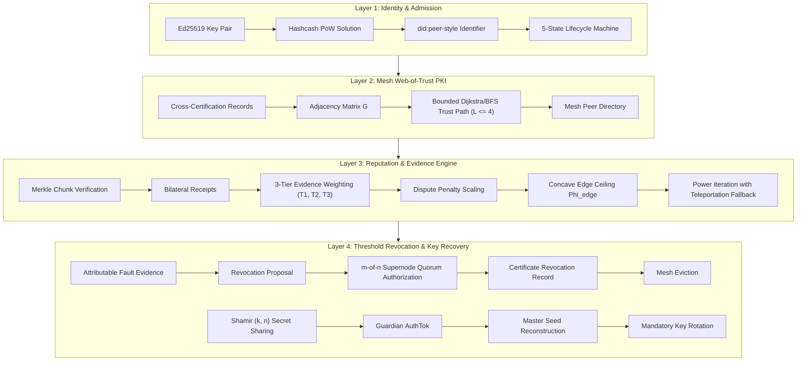

# Final Case Study Synthesis: PKI-Based Trust Management for Peer-to-Peer File-Sharing and Social Networking Platforms (v6.0-FINAL-FREEZE)

**Document Version:** 6.0.0-FINAL-FREEZE  
**Date:** October 9, 2026  
**Author:** Candidate Shreyan Nayak (23BKT0039)  
**Technical Consistency Reference:** [`PHASE8_9_INTEGRITY_AND_FREEZE_REPORT.md`](file:///d:/pki_casestudy/PHASE8_9_INTEGRITY_AND_FREEZE_REPORT.md)  
**Target Specifications & Gate Reviews:**  
- [`PROTOCOL_SPEC.md`](file:///d:/pki_casestudy/PROTOCOL_SPEC.md) (v2.2.0-FROZEN)  
- [`SECURITY_MODEL.md`](file:///d:/pki_casestudy/SECURITY_MODEL.md) (v2.2.0-FROZEN)  
- [`reports/PROTOCOL_FINAL_CORRECTION_REPORT.md`](file:///d:/pki_casestudy/reports/PROTOCOL_FINAL_CORRECTION_REPORT.md)  
- [`NOVEL_TRUST_ALGORITHM_DESIGN_V1_8.md`](file:///d:/pki_casestudy/NOVEL_TRUST_ALGORITHM_DESIGN_V1_8.md)  
- [`PHASE8_1_IMPLEMENTATION_REPORT.md`](file:///d:/pki_casestudy/PHASE8_1_IMPLEMENTATION_REPORT.md)  
- [`PHASE8_2_PREREGISTRATION.md`](file:///d:/pki_casestudy/PHASE8_2_PREREGISTRATION.md)  
- [`PHASE8_2_BENCHMARK_REPORT.md`](file:///d:/pki_casestudy/PHASE8_2_BENCHMARK_REPORT.md)  
- [`PHASE8_3_REPRODUCIBILITY_AUDIT.md`](file:///d:/pki_casestudy/PHASE8_3_REPRODUCIBILITY_AUDIT.md)  
- [`PHASE8_5_FINAL_CONSISTENCY_REPORT.md`](file:///d:/pki_casestudy/PHASE8_5_FINAL_CONSISTENCY_REPORT.md)  
- [`PHASE8_6_SUBMISSION_READINESS_REPORT.md`](file:///d:/pki_casestudy/PHASE8_6_SUBMISSION_READINESS_REPORT.md)  
- [`PHASE8_7_FINAL_FREEZE_REPORT.md`](file:///d:/pki_casestudy/PHASE8_7_FINAL_FREEZE_REPORT.md)  
- [`PHASE8_8_FINAL_FREEZE_REPORT.md`](file:///d:/pki_casestudy/PHASE8_8_FINAL_FREEZE_REPORT.md)  
- [`PHASE8_9_INTEGRITY_AND_FREEZE_REPORT.md`](file:///d:/pki_casestudy/PHASE8_9_INTEGRITY_AND_FREEZE_REPORT.md)  

---

## 1. Research Problem and Motivation

### 1.1 The Decentralized Trust Dilemma
Traditional Public Key Infrastructure (PKI) relies on centralized Certificate Authorities (CAs) to establish identity authenticity and trust. In decentralized peer-to-peer (P2P) systems, this centralized root of trust represents a single point of failure, a vector for censorship, and a structural mismatch with the underlying network topology. 

Without centralized gatekeepers, decentralized networks face fundamental security challenges:
1. **Zero-Cost Identity Creation (Sybil Threat):** Adversaries can generate arbitrary numbers of pseudonymous identities at negligible cost to swamp honest peer votes.
2. **Attributable Inconsistent Delivery vs. Slander:** When a node serves corrupted data (e.g., poisoned file chunks), simple unauthenticated complaint mechanisms allow malicious downloaders to frame honest providers (slander), while naive reputation aggregation allows colluders to inflate each other's standing (collusion). Attributing fault without downloading full payloads requires cryptographic contradiction proofs. A failed Merkle proof alone does not prove third-party attributable inconsistency; certified contradiction requires authentic proof of the committed chunk hash conflicting with a signed delivery envelope for that exact chunk index.
3. **Collusion and Edge Grinding:** Strategic colluders can exchange synthetic positive ratings amongst themselves without performing genuine work, manufacturing artificial reputation to capture network trust.
4. **Key Compromise and Revocation Deadlock:** In the absence of a central directory, disseminating key revocation records and recovering lost or compromised master keys without central custodians requires fault-tolerant threshold authorization (3-of-5 supernode quorum signatures).

### 1.2 Dual Application Context: P2P File Sharing and Social Networking
The research problem spans two distinct peer-to-peer paradigms:
- **P2P File-Sharing Platforms (e.g., BitTorrent, IPFS):** Trust is operational, transactional, and objective. It governs content authenticity, delivery fulfillment, bandwidth reciprocity, chunk integrity, and non-repudiation of transfer failures.
- **P2P Social-Networking Platforms (e.g., Nostr, Scuttlebutt, Matrix, Mastodon):** Trust is relational, subjective, and identity-centric. It governs user impersonation, friendship/follow assertions, message attestation, spam/harassment mitigation, and social account recovery following device compromise.

---

## 2. Research Objectives and Explicit Scope Alignment

To maintain strict scientific integrity, this research delineates its contributions across three clearly bounded categories:

```
┌──────────────────────────────────────────────────────────────────────────┐
│                   SHARED DECENTRALIZED TRUST INFRASTRUCTURE              │
│  Layer 1: Identity & PoW   │  Layer 2: Mesh Web-of-Trust PKI             │
│  Layer 3: EigenTrust v1.8  │  Layer 4: Threshold Revocation & Recovery   │
└────────────────────────────────────┬─────────────────────────────────────┘
                                     │
           ┌─────────────────────────┴─────────────────────────┐
           ▼                                                   ▼
┌──────────────────────────────────────┐    ┌──────────────────────────────────────┐
│       IMPLEMENTED & EVALUATED        │    │        CONCEPTUAL APPLICATION        │
│          APPLICATION DOMAIN          │    │          EXTENSION DOMAIN            │
│ ──────────────────────────────────── │    │ ──────────────────────────────────── │
│ • P2P File Sharing (SwarmSimulation) │    │ • Decentralized Social Networking    │
│ • Merkle Chunk Trees & Proofs        │    │ • Follows vs Endorsements vs Certs   │
│ • Delivery Envelopes & Manifests     │    │ • Unilateral Message Attestations    │
│ • Attributable Fault Contradiction   │    │ • Social Guardian Secret Recovery    │
│ • Collusion & Grinding Benchmarks    │    │ • Sybil Cluster Moderation Dynamics  │
│ [Empirically Validated: Phases 5-8]  │    │ [Architecturally Specified: Phase 8] │
└──────────────────────────────────────┘    └──────────────────────────────────────┘
```

1. **Shared Trust Infrastructure (Implemented Reference Code & Test-Suite Verified in Simulation):**
   A four-layer decentralized PKI protocol comprising cryptographic peer identities (`did:peer`-style syntax), Hashcash proof-of-work admission barriers, Web-of-Trust bounded path discovery, evidence-weighted reputation propagation, and threshold certificate revocation with Shamir secret sharing. Verified across 75 automated unit and regression tests in Python (61 in `tests/test_trust_framework.py` and 14 in `tests/test_ew_eigentrust.py`).
   > [!NOTE]
   > Software test-suite execution verifies programmatic adherence to specified requirements in Python; it does not constitute mathematical formal verification (such as machine-checked proofs in Coq or Isabelle), a cryptographic reduction proof, or production-grade network deployment.
2. **Implemented and Evaluated Application Domain (P2P File Sharing):**
   Full implementation of content-addressed chunk transfers, cryptographic manifests, binary Merkle tree proofs, delivery verification envelopes, attributable fault evidence generation, and empirical evaluation under adversarial conditions (poisoning, replay, receipt grinding, closed collusion, leaky collusion, and adaptive attackers).
3. **Social-Networking Applicability (Conceptual Architecture & Transfer Formulation):**
   A structural mapping explaining how the shared four-layer infrastructure extends to decentralized social networks. **Scope Boundary:** No custom social network simulator, user-feed dataset, or social graph empirical experiment was executed. Social networking applicability is strictly formulated as a theoretical and architectural generalization.

---

## 3. Background and Related-Work Positioning

The framework synthesizes and improves upon foundational literature across distributed systems and applied cryptography:

1. **Decentralized Identity:** 
   Derives self-certifying, offline-resolvable cryptographic identifiers from Ed25519 public keys using a custom `did:peer`-style string syntax (`did:peer:2.Ez<64-hex>`). Note that this implementation does **NOT** conform to the official Decentralized Identity Foundation (DIF) `did:peer` Method 2 encoding (which mandates multicodec prefixes, multibase base58btc encoding `z...`, and purpose code `V` for verification keys rather than `E`), nor has full W3C DID Core conformance been validated in code (Hardman, Curran, & Curren, 2021; W3C, 2022).
2. **Sybil Resistance:**
   Integrates Hashcash-style proof-of-work (Back, 2002) at identity generation. While PoW does not prevent determined hardware-scale Sybil creation, it imposes a strictly verified computational cost ($O(2^d)$ hash trials) that eliminates zero-cost identity generation.
3. **Web-of-Trust PKI:**
   Extends PGP Web-of-Trust principles (Zimmermann, 1995) to dynamic mesh topologies. Peers cross-certify public keys with Ed25519 signatures, enabling multi-hop trust paths bounded by a strict hop limit ($L_{\max} = 4$) with multiplicative path decay.
4. **Spectral Reputation & EigenTrust:**
   Builds upon the seminal EigenTrust algorithm (Kamvar, Schlosser, & Garcia-Molina, 2003). While vanilla EigenTrust relies on linear satisfaction accumulation $S_{ij} = \sum \text{sat} - \sum \text{unsat}$, our protocol introduces **Evidence-Weighted EigenTrust v1.8 (`EVIDENCE_ONLY`)**, incorporating concave saturation ceilings ($\Phi_{\text{edge}}$), 3-tier delivery verification, exponential freshness decay, dispute accounting, and certified fault nullification.
5. **Fault Attribution & Merkle Proofs:**
   Implements Merkle inclusion proofs (Merkle, 1980) over file chunk digests. In contrast to naive dispute mechanisms, fault attribution requires a cryptographic contradiction proof: the server's Ed25519 signature over a chunk hash combined with an authentic Merkle inclusion proof proving that a different chunk hash was committed to the publisher's root for that exact chunk index.
6. **Threshold Cryptography:**
   Employs Shamir's $(k, n)$ Threshold Secret Sharing (Shamir, 1979) over $GF(256)$ combined with guardian-signed Recovery Authorization Tokens (`AuthTok`) to achieve verifiable master key recovery without central key escrow.

---

## 4. Consolidated Technical Architecture

The architecture enforces a strict four-layer separation of concerns:



### Layer 1: Cryptographic Identity & Admission Barrier
- **Identifier Generation:** Node generates an Ed25519 signing key pair. In the reference implementation (`src/layer1_identity.py`), the DID string is formatted as `did:peer:2.Ez{public_key_hex}` using the 64-character lowercase hex representation of the public key.
  > [!NOTE]
  > **Non-Compliance Note on DIF `did:peer` numalgo 2:**  
  > The emitted string `did:peer:2.Ez<64-hex>` is a simulation-specific custom identifier and is **NOT compliant** with the official DIF `did:peer` Method 2 specification:
  > 1. In the DIF specification, purpose codes designate method usage: `V` denotes verification/assertion (signing) methods, whereas `E` specifically denotes key-agreement/encryption methods (e.g., X25519). Using `E` for an Ed25519 signing key contradicts the spec.
  > 2. DIF numalgo 2 requires multicodec prefixing (`0xed01` for Ed25519) followed by multibase base58btc encoding (beginning with `z`), rather than raw lowercase hexadecimal.
  > 3. Claims of "adopting did:peer Method 2" or "conforming to W3C DID Core" are unsupported by the reference code, which implements a lightweight simulation string format.
- **Proof-of-Work Admission Barrier:** Node computes a SHA-256 Hashcash nonce satisfying difficulty $d$ ($H(DID \parallel \text{nonce}) < 2^{256-d}$). Verification is $O(1)$. This imposes a computational cost barrier ($O(2^d)$ hash trials) that eliminates zero-cost identity generation, though it does not prevent well-resourced adversaries.
- **Finite State Machine:** Peer states follow the strict 5-state lifecycle defined in `PROTOCOL_SPEC.md` (§2.1):
  $$\text{UNKNOWN} \xrightarrow{\text{T1}} \text{ACTIVE} \underset{\text{T3a}}{\overset{\text{T2}}{\longleftrightarrow}} \text{SUSPECTED} \xrightarrow{\text{T4}} \text{REVOCATION\_PROPOSED} \xrightarrow{\text{T5a}} \text{REVOKED}$$
  - **T1 (Admission):** `UNKNOWN` $\to$ `ACTIVE` upon valid PoW and self-signature.
  - **T2 (Suspicion):** `ACTIVE` $\to$ `SUSPECTED` upon attributable fault evidence or unverified suspicion.
  - **T3a (Subjective Exoneration):** `SUSPECTED` $\to$ `ACTIVE` upon expiration of $T_{\text{susp}}$ for unverified suspicion. Certified fault suspicion (T3b) persists indefinitely.
  - **T4 (Escalation):** `SUSPECTED` $\to$ `REVOCATION_PROPOSED` upon formal supernode committee proposal.
  - **T5a (Quorum Eviction):** `REVOCATION_PROPOSED` $\to$ `REVOKED` upon assembling $m$-of-$n$ supernode signatures on a CRR.
  - **T5b (Quorum Timeout Fallback):** If $T_{\text{vote}}$ expires without reaching quorum ($k < m$), the state **reverts to `SUSPECTED`, never directly to `ACTIVE`**.

### Layer 2: Mesh Web-of-Trust PKI
- **Cross-Certification:** Peers issue signed `CrossCertificate` records asserting unidirectional trust with valid time windows $[t_{\text{valid}}, t_{\text{expires}}]$.
- **Bounded Path Discovery:** Shortest trust paths are computed using Dijkstra/BFS with a maximum path length $L \le 4$ hops. Cumulative trust along path $P = (v_0, v_1, \dots, v_k)$ decays multiplicatively:
  $$w(P) = \prod_{i=0}^{k-1} w(v_i, v_{i+1}) \cdot \beta^k, \quad \beta = 0.90$$
- **Pre-Trusted Backbone:** Bootstrapped via 5 pre-trusted supernodes ($S \subset V$) with static trust distribution $\mathbf{p}$ ($p_s = 1/|S|$ for $s \in S$, $p_i = 0$ otherwise). Supernode election (`elect_supernodes`) is explicitly disabled (`NotImplementedError`) per `PROTOCOL_SPEC.md` §3.3.

### Layer 3: Evidence-Weighted EigenTrust v1.8 (`EVIDENCE_ONLY`)
- **Evidence Weighting ($\gamma_{\text{ev}}$):** Replaces linear satisfaction with a 3-tier evidence classification:
  - **Tier 1 (Unverified Receipts):** Missing, malformed, or unindexed delivery references receive heavy discounting ($\mu_{\text{unverified}} = 0.10$).
  - **Tier 2 (Referenced Receipts):** Receipts referencing an indexed Content Manifest receive moderate discounting ($\mu_{\text{referenced}} = 0.25$).
  - **Tier 3 (Cryptographically Verified Deliveries):** Receipts referencing a verified chunk delivery key matching local client verification receive full credit ($\gamma_{\text{ev}} = 1.00$).
- **Freshness Decay ($\gamma_{\text{fresh}}$):** Exponential timestamp decay $\gamma_{\text{fresh}} = \exp(-\Delta t / \tau)$, where $\tau = 86,400\text{ s}$ (24 hours).
- **Dispute Accounting ($\gamma_{\text{dispute}}$):** Subjective negative receipts (`rating == -1.00`) scale edge weight via $\gamma_{\text{dispute}} = 1.0 / (1.0 + \kappa \cdot N_{\text{dispute}})$, $\kappa = 0.50$.
- **Certified Fault Nullification:** Attributable `FaultEvidenceRecord` completely nullifies the accused peer's outgoing and incoming edge weights ($A_{ij} = 0, A_{ji} = 0$).
- **Concave Edge Ceiling ($\Phi_{\text{edge}}$):** Bounded saturation function capping total effective evidence per directed edge:
  $$\Phi_{\text{edge}}(E_{ij}) = K_{\max} \cdot \frac{E_{ij}}{E_{ij} + \lambda_{\text{sat}}}, \quad K_{\max} = 10.0, \, \lambda_{\text{sat}} = 0.50$$
- **Dangling-Node Fallback Rule:** If a node $i$ has zero positive outgoing edge weight ($\sum_j A_{ij} = 0$), the normalized transition row falls back to the **pre-trusted teleportation restart vector $\mathbf{p}$** ($C'_{i, :} = \mathbf{p}$), as specified in `NOVEL_TRUST_ALGORITHM_DESIGN_V1_8.md` and implemented in `src/layer3_eigentrust.py:1218`.
- **Power Iteration Convergence:** Solves the stationary distribution $\mathbf{t} = (1 - \alpha) (\mathbf{C}')^T \mathbf{t} + \alpha \mathbf{p}$ with damping $\alpha = 0.15$ and convergence tolerance $\epsilon = 10^{-6}$.

### Layer 4: Threshold Revocation & Key Recovery
- **Quorum Eviction:** Revocation of compromised or malicious peers requires a Certificate Revocation Record (CRR) bearing $m$-of-$n$ valid supernode signatures ($m = 3, n = 5$). Valid CRRs trigger network-wide peer eviction and link severance.
- **Key Recovery:** Master identity keys are protected via Shamir $(k, n)$ secret sharing ($k = 3, n = 5$) over $GF(256)$. Reconstruction requires $k$ authenticated Recovery Authorization Tokens (`AuthTok`). Mandatory post-recovery key rotation invalidates the compromised key and establishes a dual-signed rotation link.

---

## 5. Implementation Status and Testing Evidence

The protocol is implemented in Python across modular components in `src/`:

| Module Path | Core Responsibilities | Implementation Status | Automated Test Suite Coverage |
| :--- | :--- | :---: | :---: |
| [`src/layer1_identity.py`](file:///d:/pki_casestudy/src/layer1_identity.py) | Ed25519 keys, `did:peer`-style derivation, PoW Hashcash, 5-state lifecycle | Protocol Frozen (Simulation Implementation) | Test-Suite Verified (`test_trust_framework.py`: 4 tests) |
| [`src/layer2_mesh_pki.py`](file:///d:/pki_casestudy/src/layer2_mesh_pki.py) | Mesh network, cross-certification, Dijkstra trust paths, hop limits | Protocol Frozen (Simulation Implementation) | Test-Suite Verified (`test_trust_framework.py`: 5 tests) |
| [`src/layer3_eigentrust.py`](file:///d:/pki_casestudy/src/layer3_eigentrust.py) | Merkle trees, Bilateral Receipts, FaultEvidenceRecord verification, EW-EigenTrust v1.8, Evidence Journal | Protocol Frozen (Simulation Implementation) | Test-Suite Verified (`test_trust_framework.py`: 9 tests; `test_ew_eigentrust.py`: 14 tests) |
| [`src/layer4_recovery.py`](file:///d:/pki_casestudy/src/layer4_recovery.py) | CRR quorum authorization, peer eviction, Shamir recovery, rotation | Protocol Frozen (Simulation Implementation) | Test-Suite Verified (`test_trust_framework.py`: 1 test direct + 9 Phase 4 tests) |
| [`src/network_simulator.py`](file:///d:/pki_casestudy/src/network_simulator.py) | Integrated multi-layer simulation harness (`SwarmSimulation`) | Protocol Frozen (Simulation Implementation) | Test-Suite Verified (`test_trust_framework.py`: 33 Phase 3/5/6 tests) |

### Test Suite Execution Evidence
The complete test suite runs deterministically via standard unittest discovery:
```powershell
python -m unittest discover -s tests -v
```
**Reproducible Test Breakdown by Module and Class (Logged to `tests_scratch/unittest_phase8_9.log`):**

1. **`tests/test_ew_eigentrust.py` (14 tests across 6 classes):**
   - `TestEWIdentifierLifecycleAndDeliveryTiers`: 6 tests (`test_01` to `test_06`)
   - `TestEWEvidenceFreshnessAndDispute`: 3 tests (`test_07` to `test_09`)
   - `TestEWCertifiedFaultNullification`: 1 test (`test_10`)
   - `TestEWEdgeBoundsAndRobustness`: 2 tests (`test_11`, `test_12`)
   - `TestEWVanillaEquivalence`: 1 test (`test_13`)
   - `TestEndToEndSimulationTrace`: 1 test (`test_14`)
2. **`tests/test_trust_framework.py` (61 tests in class `TestPKITrustFramework`):**
   - Layer 1 Unit Tests (`test_layer1_*`): 4 tests
   - Layer 2 Unit Tests (`test_layer2_*`): 5 tests
   - Layer 3 Unit Tests (`test_layer3_*`): 9 tests
   - Layer 4 Unit Tests (`test_layer4_*`): 1 test
   - Phase 3 Accounting Tests (`test_phase3_*`): 11 tests
   - Phase 4 Revocation & Recovery Tests (`test_phase4_*`): 9 tests
   - Phase 5 Integration Tests (`test_phase5_integration_*`): 10 tests
   - Phase 6 Benchmark Regression Tests (`test_phase6_*`): 12 tests
- **Total Discovered & Passing:** Exactly **75 tests** (`Ran 75 tests in 4.964s, OK` in Phase 8.9 execution).

> [!NOTE]
> Passing 75 automated test cases verifies implementation consistency against the test suite. It does not establish mathematical formal verification or readiness for production deployment on decentralized networks.

---

## 6. Experimental Methodology and Empirical Results

The empirical evaluation of EW-EigenTrust v1.8 was conducted under Phase 8.2 and reported in the Phase 8.3 reproducibility audit:
- **Preregistration:** Sealed in [`PHASE8_2_PREREGISTRATION.md`](file:///d:/pki_casestudy/PHASE8_2_PREREGISTRATION.md) prior to running trials.
- **Seeds:** 20 paired random seeds ($\mathcal{S} = \{42 + 17 \cdot i \mid i \in [0, 19]\}$).
- **Network Scales:** Standard Scale (20–35 nodes) and Extended Scale (30–50 nodes).
- **Execution Matrix:** 9 distinct scenarios, 3 trust computation modes (`VANILLA`, `EVIDENCE_ONLY`, `LOCAL_ONLY`), totaling 1,140 individual trial evaluations.
- **Data Source Files on Disk:** [`results/phase8_2_statistical_comparison.csv`](file:///d:/pki_casestudy/results/phase8_2_statistical_comparison.csv), [`results/phase8_2_summary.csv`](file:///d:/pki_casestudy/results/phase8_2_summary.csv), and [`results/phase8_2_raw_results.json`](file:///d:/pki_casestudy/results/phase8_2_raw_results.json).

### 6.1 Master Empirical Results Summary

| Scenario | Scale | Vanilla EigenTrust $T_C$ | EW-EigenTrust v1.8 $T_C$ | Difference $\Delta$ | Rel. Change | Paired $t$-stat | $p$-value | Cohen's $d_z$ | Empirical Outcome |
| :--- | :---: | :---: | :---: | :---: | :---: | :---: | :---: | :---: | :--- |
| **S1: Honest Baseline** | Standard | $0.0000$ | $0.0000$ | $0.0000$ | $0.00\%$ | $0.00$ | $1.000$ | $0.00$ | Simplex conserved ($\sum t_i = 1.0$) |
| **S1: Honest Baseline** | Extended | $0.0000$ | $0.0000$ | $0.0000$ | $0.00\%$ | $0.00$ | $1.000$ | $0.00$ | Structural zero: zero colluders |
| **S2: Closed Collusion** | Standard | $0.0850$ | $0.0889$ | $+0.0039$ | $+4.53\%$ | $+1.472$ | $0.158$ | $+0.33$ | No statistically significant reduction ($p = 0.158$) |
| **S2: Closed Collusion** | Extended | $0.0539$ | $0.0611$ | $+0.0073$ | $+13.50\%$ | $+3.944$ | $8.70 \times 10^{-4}$ | $+0.88$ | Statistically significant colluder gain ($p = 8.70 \times 10^{-4}$) |
| **S3: Leaky Collusion** | **Standard** | **$0.1834$** | **$0.1084$** | **$-0.0750$** | **$-40.88\%$** | **$-34.354$** | **$1.44 \times 10^{-18}$** | **$-7.68$** | **Collusion suppression in leaky topologies** |
| **S3: Leaky Collusion** | **Extended** | **$0.1982$** | **$0.1160$** | **$-0.0823$** | **$-41.50\%$** | **$-50.410$** | **$1.07 \times 10^{-21}$** | **$-11.27$** | **Collusion suppression in leaky topologies** |
| **S4: Connected ($q=0.00$)**| Standard | $0.0000$ | $0.0000$ | $0.0000$ | $0.00\%$ | $0.00$ | $1.000$ | $0.00$ | Disconnected: structural zero |
| **S4: Connected ($q=0.05$)**| Standard | $0.0935$ | $0.1176$ | $+0.0242$ | $+25.89\%$ | $+11.757$ | $3.66 \times 10^{-10}$ | $+2.63$ | Low bridge: statistically significant colluder gain ($p = 3.66 \times 10^{-10}$) |
| **S4: Connected ($q=0.10$)**| Standard | $0.1606$ | $0.1885$ | $+0.0279$ | $+17.34\%$ | $+13.621$ | $2.96 \times 10^{-11}$ | $+3.05$ | Moderate bridge: statistically significant colluder gain ($p = 2.96 \times 10^{-11}$) |
| **S4: Connected ($q=0.20$)**| Standard | $0.2731$ | $0.2920$ | $+0.0189$ | $+6.92\%$ | $+9.209$ | $1.95 \times 10^{-8}$ | $+2.06$ | Transition region: statistically significant colluder gain ($p = 1.95 \times 10^{-8}$) |
| **S4: Connected ($q=0.40$)**| Standard | $0.4124$ | $0.4045$ | $-0.0079$ | $-1.90\%$ | $-4.799$ | $1.25 \times 10^{-4}$ | $-1.07$ | High bridge: small statistically significant reduction ($-1.90\%, p = 1.25 \times 10^{-4}$) |
| **S5: Adaptive Attacker** | Standard | $0.0964$ | $0.1004$ | $+0.0040$ | $+4.16\%$ | $+1.739$ | $0.098$ | $+0.39$ | No statistically significant difference ($p = 0.098$) |
| **S6: Receipt Grinding** | Standard | $0.0922$ | $0.1046$ | $+0.0123$ | $+13.38\%$ | $+3.860$ | $1.06 \times 10^{-3}$ | $+0.86$ | **H-1 Refuted: colluders gain trust ($p = 1.06 \times 10^{-3}$)** |
| **S6: Receipt Grinding** | Extended | $0.0558$ | $0.0658$ | $+0.0100$ | $+17.92\%$ | $+4.968$ | $8.55 \times 10^{-5}$ | $+1.11$ | **H-1 Refuted: colluders gain trust ($p = 8.55 \times 10^{-5}$)** |
| **S7: Dispute Manip** | Standard | $0.0000$ | $0.0000$ | $0.0000$ | $0.00\%$ | $0.00$ | $1.000$ | $0.00$ | **Structurally degenerate zero** |
| **S8: Asym Uploader** | Standard | $0.0000$ | $0.0000$ | $0.0000$ | $0.00\%$ | $0.00$ | $1.000$ | $0.00$ | **Uploader trust $+11.43\%$ ($1.114$ ratio, H-2 Confirmed)** |
| **S8: Asym Uploader** | Extended | $0.0000$ | $0.0000$ | $0.0000$ | $0.00\%$ | $0.00$ | $1.000$ | $0.00$ | **Uploader trust $+12.74\%$ ($1.127$ ratio, H-2 Confirmed)** |
| **S9: Reciprocal Comm** | Standard | $0.0000$ | $0.0000$ | $0.0000$ | $0.00\%$ | $0.00$ | $1.000$ | $0.00$ | Honest community share = $100\%$ (H-4 Confirmed) |
| **S9: Reciprocal Comm** | Extended | $0.0000$ | $0.0000$ | $0.0000$ | $0.00\%$ | $0.00$ | $1.000$ | $0.00$ | Zero suppression or distortion (H-4 Confirmed) |

> [!NOTE]
> **Note on Statistical Reporting:**  
> All reported $p$-values are paired $t$-test values uncorrected for multiple comparisons across the 9 scenarios, as preregistered in Phase 8.2.

### 6.2 Explicit Diagnosis of Scenario 7 Degeneracy
In Scenario 7, colluder trust share is reported as $0.0000$ under both Vanilla EigenTrust and EW-EigenTrust across all seeds.  
**Root Cause Analysis:**  
In the benchmark implementation ([`experiments/phase8_2_benchmark.py:707-746`](file:///d:/pki_casestudy/experiments/phase8_2_benchmark.py#L707-L746), transaction loop lines 723–744), honest nodes and supernodes strictly selected transaction partners from within their own honest candidate pool (`hn + sn`). Consequently, honest peers never transacted with or rated colluders, meaning incoming normalized bridge flow was identically zero ($C'_{hc} = 0$).  
Furthermore, colluders had zero pre-trust allocation ($p_c = 0$). Because colluders exchanged internal ratings, their internal row sums were positive ($\sum_{c' \in C} A_{c c'} > 0$), so no dangling-row fallback was triggered. Moreover, under the engine's dangling fallback rule ($C'_{i, :} = \mathbf{p}$), even if a colluder were dangling, its transition mass would fall back to $\mathbf{p}$, which is concentrated entirely on honest supernodes ($p_c = 0$). Under either fallback rule ($\mathbf{p}$ or $1/n$), the non-homogeneous source term entering the coalition is zero:
$$\left[\mathbf{I} - (1 - \alpha)(\mathbf{C}'_{CC})^T\right] \mathbf{t}_C = (1 - \alpha)(\mathbf{C}'_{HC})^T \mathbf{t}_H + \alpha \mathbf{p}_C = \mathbf{0}$$
Since $(1 - \alpha) < 1$ and $\mathbf{C}'_{CC}$ is sub-stochastic or stochastic, $\left[\mathbf{I} - (1 - \alpha)(\mathbf{C}'_{CC})^T\right]$ is strictly non-singular, uniquely forcing $\mathbf{t}_C = \mathbf{0}$.  
**Conclusion:** Colluder trust share is zero due to **topological disconnection (a structurally degenerate baseline metric)**, not dynamic dispute handling. While Scenario 7 verified that dispute receipts do not trigger false CRR revocations, it did not test dispute defense against active bridge ingress.

---

## 7. Discussion of Negative Findings and Threats to Validity

### 7.1 Mathematical Derivation of the Closed-Set Flow Identity and Refutation of H-1

#### Complete Derivation from the Stationary EigenTrust Equation
Let $V = H \cup C$ be the set of peers partitioned into honest peers $H$ (including pre-trusted supernodes $S \subseteq H$) and colluders $C$ ($H \cap C = \emptyset$). Let $\mathbf{C}' \in \mathbb{R}^{n \times n}$ denote the row-stochastic normalized transition matrix where $\sum_{j \in V} C'_{ij} = 1$ for all $i \in V$.

The stationary trust vector $\mathbf{t} \in \mathbb{R}$ ($\sum_{i \in V} t_i = 1$) satisfies:
$$\mathbf{t} = (1 - \alpha) (\mathbf{C}')^T \mathbf{t} + \alpha \mathbf{p}$$
In component form for each node $j$:
$$t_j = (1 - \alpha) \sum_{i \in V} C'_{ij} t_i + \alpha p_j$$
Summing over all nodes $c \in C$ in the colluder coalition:
$$\sum_{c \in C} t_c = (1 - \alpha) \sum_{c \in C} \sum_{i \in V} C'_{ic} t_i + \alpha \sum_{c \in C} p_c$$
Splitting the sum over $i \in V$ into honest nodes $h \in H$ and colluders $c' \in C$:
$$\sum_{c \in C} t_c = (1 - \alpha) \left[ \sum_{c \in C} \sum_{h \in H} C'_{hc} t_h + \sum_{c \in C} \sum_{c' \in C} C'_{c' c} t_{c'} \right] + \alpha \sum_{c \in C} p_c$$
Interchanging the summation order in the internal coalition term:
$$\sum_{c \in C} \sum_{c' \in C} C'_{c' c} t_{c'} = \sum_{c' \in C} t_{c'} \left( \sum_{c \in C} C'_{c' c} \right)$$

#### Three Structural Assumptions
1. **Strict Coalition Closure:** Colluders assign zero outgoing trust to honest peers:
   $$\forall c' \in C, \forall h \in H: C'_{c' h} = 0$$
2. **Zero Teleportation Mass on Coalition Nodes:** Pre-trust is concentrated entirely on honest supernodes ($S \subseteq H$), so:
   $$\sum_{c \in C} p_c = 0$$
3. **No Dangling Coalition Rows:** For every $c' \in C$, the internal unnormalized edge sum is strictly positive ($\sum_{c \in C} A_{c' c} > 0$).  
   Row stochasticity therefore ensures:
   $$\sum_{c \in C} C'_{c' c} = 1.0$$
   *(Note: As established in Phase 8.8, even if a colluder were dangling, falling back to the restart vector $\mathbf{p}$ injects zero teleportation into the coalition because $\sum_{c \in C} p_c = 0$, preserving the closed flow boundary).*

#### The Closed-Set Flow Identity Equation
Substituting these conditions into the coalition sum:
$$\sum_{c \in C} t_c = (1 - \alpha) \left[ \sum_{h \in H} t_h \sum_{c \in C} C'_{hc} + \sum_{c \in C} t_c \right]$$
Subtracting $(1 - \alpha) \sum_{c \in C} t_c$ from both sides:
$$\alpha \sum_{c \in C} t_c = (1 - \alpha) \sum_{h \in H} t_h \sum_{c \in C} C'_{hc}$$
Dividing by $\alpha$ yields the exact relationship:
$$T_C = \sum_{c \in C} t_c = \left(\frac{1 - \alpha}{\alpha}\right) F_{H \to C}$$
where $F_{H \to C} \equiv \sum_{h \in H} t_h \sum_{c \in C} C'_{hc}$ is the **trust-weighted incoming flow**.

#### Separation: The Flow Identity vs. The Invariance Condition
The flow identity $T_C = \frac{1 - \alpha}{\alpha} F_{H \to C}$ holds whenever the three structural assumptions (closure, zero teleportation mass, and no dangling coalition rows) are satisfied.

However, for aggregate coalition trust $T_C$ to remain strictly **invariant** across internal edge-weight alterations, an **additional condition** is required: **the trust-weighted incoming flow $F_{H \to C}$ must remain constant**.

**Critical Distinction: Aggregate Transition Probability vs. Trust-Weighted Flow:**  
Fixed aggregate transition probabilities $\sum_{c \in C} C'_{hc}$ alone are **not** sufficient to guarantee trust invariance if the honest stationary trust distribution $\mathbf{t}_H$ changes. Because $F_{H \to C} = \sum_{h \in H} t_h \left(\sum_{c \in C} C'_{hc}\right)$, shifts in honest stationary trust $t_h$ directly alter coalition trust.  
Furthermore, $C'_{hc} = A_{hc} / \sum_{k \in V} A_{hk}$. Even if the bridge edge weight $A_{hc}$ is constant, if honest bridge nodes $h$ saturate their internal honest edges, the normalization denominator $\sum_{k \in V} A_{hk}$ changes, altering $C'_{hc}$.

#### Empirical Manifestation in Scenario 6 (H-1 Refutation) and Scenarios 2 & 4
In Scenario 6 (Receipt Grinding), colluders generated 50 synthetic internal receipts per edge. While EW-EigenTrust discounted and capped internal edges via $\Phi_{\text{edge}}$, symmetric internal scaling meant row normalization ($C'_{c' c} = A_{c' c} / \sum_k A_{c' k}$) preserved $\sum_{c \in C} C'_{c' c} = 1.0$.

Across empirical trials under closed or bridged collusion, EW-EigenTrust **did not reduce** colluder trust share. Instead:
- In Scenario 2 Extended, colluders gained a statistically significant $+13.50\%$ trust share ($p = 8.70 \times 10^{-4}$).
- In Scenario 4 with bridge probability $q \in \{0.05, 0.10, 0.20\}$, colluders gained statistically significant trust ($+25.89\%, p = 3.66 \times 10^{-10}$ at $q = 0.05$; $+17.34\%, p = 2.96 \times 10^{-11}$ at $q = 0.10$; $+6.92\%, p = 1.95 \times 10^{-8}$ at $q = 0.20$). Only at high bridge probability $q = 0.40$ was a small statistically significant reduction observed ($-1.90\%, p = 1.25 \times 10^{-4}$).
- In Scenario 6 (Receipt Grinding), colluders gained a statistically significant $+13.38\%$ in standard scale ($p = 1.06 \times 10^{-3}$) and $+17.92\%$ in extended scale ($p = 8.55 \times 10^{-5}$), formally **refuting preregistered Hypothesis H-1**.

> [!IMPORTANT]
> **Explaining the Direction of Change:**  
> The stationary flow identity $T_C = \frac{1-\alpha}{\alpha} F_{H \to C}$ relates coalition trust to incoming flow, but it **does not predict the direction of change** (whether $T_C$ increases, decreases, or stays constant under algorithmic modifications). Explaining why colluder trust share increased in these scenarios would require evaluating the per-trial trust-weighted incoming flow $F_{H \to C} = \sum_{h \in H} t_h \sum_{c \in C} C'_{hc}$, which was not recorded in the benchmark output files. While denominator compression on honest bridge nodes is a hypothesized mechanism, it was not directly tested against serialized per-trial transition matrices.

> [!CAUTION]
> The Closed-Set Flow Identity does **not** prove universal coalition resistance. Rather, it demonstrates that when a coalition maintains strict closure and zero teleportation, internal rating manipulation or symmetric internal edge ceilings alone cannot reduce aggregate stationary coalition trust unless the external trust-weighted incoming flow $F_{H \to C}$ is reduced.

---

## 7.2 Why Leaky Coalitions are Vulnerable
When colluders leak trust by interacting with honest nodes (Scenario 3), closed-set invariance breaks down. 
- Colluders' internal receipts receive Tier 1 discounting ($\mu_{\text{unverified}} = 0.10$).
- Colluders' downloads from honest nodes involve authentic chunk verification, awarding honest nodes Tier 3 credit ($\gamma_{\text{ev}} = 1.00$).

The transition probability from colluders back to honest nodes is hypothesized to be magnified relative to internal circulation (**hypothesized mechanism, not tested on per-trial matrices**). Trust drains out of the coalition into the honest community, producing a **$40.88\%$ to $41.50\%$ reduction** in colluder trust ($p < 10^{-18}, |d_z| > 7.5$).

---

## 7.3 Simulation Oracles and Decentralized Evidence Portability Gap
A critical threat to external validity is the distinction between local simulator oracles and portable decentralized evidence:
1. **Global Delivery Key Pool ($\mathcal{D}_{\text{sim}}$):** In the benchmark harness, verified delivery keys are collected globally in an in-memory set across all simulated clients. In an untrusted decentralized P2P network, an observing third-party peer evaluating edge $A \to B$ does not possess direct local verification of $B$'s chunk delivery to $A$.
2. **Third-Party Verifiability Gap:** Because the frozen `BilateralReceipt` does not carry raw chunks or Merkle inclusion proofs, observing peers cannot verify delivery integrity off-the-wire. Without portable zero-knowledge service proofs or independent delivery challenges, third-party receipts default to Tier 1 or Tier 2. The observed $+11.4\%$ to $+12.7\%$ gain for honest uploaders represents an **upper bound under complete local evidence knowledge**.
3. **Canonical Evidence Journal ($\mathcal{L}_{\text{sim}}$):** In a real mesh, peers maintain local journals ($\mathcal{L}_{\text{local}}$) and reconcile entries via gossip. Network partitions or asynchronous gossip could lead to temporary divergence in local trust views.

---

## 7.4 Computational Runtime Scaling
Under extreme receipt grinding (Scenario 6 extended scale, 152,000 journal receipts), EW-EigenTrust execution time increased from $1.81\text{ ms}$ (Vanilla) to $166.32\text{ ms}$ ($92\times$ overhead). This overhead arises from iterating over thousands of raw journal entries and performing hash-set lookups during matrix assembly. In production deployments, edge aggregation must be indexed incrementally rather than computed via full journal scans.

---

## 7.5 Local-Only Baseline Comparison
Under receipt grinding, Local-Only assigned **$99.32\%$ (standard) and $99.73\%$ (extended)** of all trust to colluders. Because Local-Only simply sums raw interaction scores without pre-trusted teleportation or global spectral normalization, colluders generating high volumes of mutual ratings completely overwhelm the honest community. This demonstrates that in the evaluated benchmark configuration, naive direct rating aggregation without pre-trusted anchoring completely collapsed under receipt grinding, whereas spectral propagation with pre-trusted anchors constrained colluder trust share (though other defense architectures remain unexamined).

---

## 8. Relevance to Both Application Domains

### 8.1 P2P File-Sharing Systems (Empirically Validated Domain)
In P2P file sharing, the protocol provides concrete, verified security properties:
- **Attributable Fault Detection:** Servers delivering corrupted file chunks are detected via Merkle inclusion contradiction proofs, enabling $O(1)$ arbiter verification without downloading full payloads.
- **Economic Admission Barrier:** PoW admission ($O(2^d)$ hash trials) eliminates zero-cost identity generation.
- **Provider Protection:** Dedicated asymmetric seeders serving high volumes of chunks receive Tier 3 verified evidence, elevating their global trust score ($+11\%$ to $+13\%$) without requiring reciprocal return downloads.
- **Collusion Bounds:** Colluders attempting to construct artificial reputation rings are dampened by $>40\%$ if they attempt to interact with or download from honest peers.

### 8.2 P2P Social-Networking Platforms (Conceptual Application Domain)
The four-layer architecture provides a direct conceptual foundation for decentralized social networks:

```
┌──────────────────────────────────────────────────────────────────────────────┐
│             P2P SOCIAL NETWORKING MAPPING (CONCEPTUAL EXTENSION)             │
├─────────────────────────┬────────────────────────────────────────────────────┤
│ Protocol Component      │ Social Network Mapping & Operational Semantics     │
├─────────────────────────┼────────────────────────────────────────────────────┤
│ Layer 1: Identity & PoW │ User profiles anchored in did:peer-style keys.     │
│                         │ Hashcash PoW throttles automated bot creation.     │
├─────────────────────────┼────────────────────────────────────────────────────┤
│ Layer 2: Web-of-Trust   │ Mutual cryptographic key cross-signing (e.g., peer │
│                         │ keysigning) establishes bounded trust paths.       │
│                         │ Note: subjective social endorsements are Layer 3  │
│                         │ reputation inputs, not Layer 2 cross-certs.        │
├─────────────────────────┼────────────────────────────────────────────────────┤
│ Layer 3: EW-EigenTrust  │ Signed interaction attestations build reputation.  │
│                         │ Subjective disputes handle spam/abuse reports.     │
├─────────────────────────┼────────────────────────────────────────────────────┤
│ Layer 4: Revocation &   │ Compromised user accounts are recovered via social │
│ Shamir Secret Recovery  │ guardians holding Shamir secret shares, enforcing  │
│                         │ mandatory post-recovery key rotation.              │
└─────────────────────────┴────────────────────────────────────────────────────┘
```

**Cryptographic Primitive Differentiation:**
- **PKI Cross-Certificates vs. Social Follows:** A PKI cross-certificate is a signed delegation statement binding a public key to an identity with explicit validity constraints. A social "follow" is an unauthenticated pub/sub subscription pointer.
- **PKI Cross-Certificates vs. Social Endorsements:** An endorsement is a subjective reputation claim (Layer 3) that does not certify cryptographic key ownership unless a separate, specified cryptographic certification mechanism exists.
- **Bilateral Receipts vs. Message Attestation:** A `BilateralReceipt` is a co-signed transactional receipt certifying bilateral agreement. A message attestation is a unilateral author signature verifying post origin.

**Missing Mechanisms Requiring Future Specification and Testing:**
To validate P2P social networking empirically, the following mechanisms must be specified and evaluated:
1. Unilateral directed graph follow/unfollow churn dynamics.
2. Content feed ranking and spam filtering algorithms without Merkle chunk trees.
3. Bot-net follow-farming attack models in power-law social topologies (e.g., Stanford SNAP datasets).
4. Social guardian threshold recovery under guardian churn and latency.

---

## 9. Final Claim and Scope Audit Table

| Claim or Contribution | Supporting Implementation / Experiment | Evidence Status | Limitations & Boundary Conditions | Recommended Report Wording |
| :--- | :--- | :---: | :--- | :--- |
| **C-01: Identity Admission Barrier** | `src/layer1_identity.py`, verified in `tests/test_trust_framework.py`. | **TEST-SUITE VERIFIED** | Imposes computational cost $O(2^d)$; does not prevent hardware-scale attackers. | *"Imposes verifiable computational cost to eliminate zero-cost identity generation; not absolute Sybil prevention."* |
| **C-02: Bounded Web-of-Trust Paths** | `src/layer2_mesh_pki.py`, verified in `tests/test_trust_framework.py`. | **TEST-SUITE VERIFIED** | Trust path decay limits reachability; relies on supernode backbone connectivity. | *"Enforces bounded multi-hop trust path validation with multiplicative decay up to 4 hops."* |
| **C-03: Merkle Fault Contradiction Proofs** | `src/layer3_eigentrust.py`, verified in `tests/test_trust_framework.py`. | **TEST-SUITE VERIFIED** | Proves attributable delivery of inconsistent data via authentic manifest, leaf proof, and server envelope; does not prove subjective malicious intent. | *"Cryptographically proves attributable delivery of inconsistent data via server-signed envelope and authentic leaf proof."* |
| **C-04: Leaky Collusion Suppression** | `experiments/phase8_2_benchmark.py`, Scenario 3 (20 seeds, 2 scales). | **EMPIRICALLY VALIDATED (SIMULATOR)** | Benefit strictly requires colluders to interact with and rate honest peers. | *"Suppresses colluder trust share by $>40\%$ in leaky coalitions where colluders interact with honest peers."* |
| **C-05: Closed-Set Flow Identity** | Mathematical derivation; observed in Scenarios 2, 4, 6 (20 seeds). | **THEORETICAL DERIVATION & EMPIRICAL OBSERVATION** | Closed-Set Flow Identity ($T_C = \frac{1-\alpha}{\alpha} F_{H \to C}$). No reduction observed under closed collusion; colluders gained trust in S2 Extended, S4 ($q \le 0.20$), and S6. | *"Does NOT defend against closed colluding coalitions under fixed incoming bridge flow; aggregate trust is dictated by external flow."* |
| **C-06: Honest Asymmetric Provider Preservation** | `experiments/phase8_2_benchmark.py`, Scenario 8 (20 seeds, 2 scales). | **EMPIRICALLY VALIDATED (SIMULATOR)** | Verified delivery (Tier 3) relies on global simulator key pool in benchmark. | *"Preserves and enhances honest asymmetric uploader trust (+11% to +13%) under verified delivery weighting in simulation."* |
| **C-07: Threshold Revocation and Key Recovery** | `src/layer4_recovery.py`, verified in `tests/test_trust_framework.py`. | **TEST-SUITE VERIFIED** | Requires $m$-of-$n$ supernode threshold authorization and honest guardian authorization. | *"Enforces threshold quorum authorization and secret-shared recovery with mandatory key rotation."* |
| **C-08: Dual-Domain Validation (P2P + Social)** | Case-study topic scope vs. `experiments/` implementation. | **QUALIFIED** | P2P file sharing is empirically validated; social networking is an architectural conceptual extension. | *"Empirically evaluated on P2P file sharing; social networking applicability is presented as a conceptual extension."* |

---

## 10. Research Contributions, Limitations, and Future Work

### 10.1 Primary Research Contributions
1. **End-to-End Four-Layer PKI Architecture:** Implemented and test-suite verified a CA-free trust architecture spanning identity admission, Web-of-Trust mesh PKI, evidence-weighted reputation, and threshold recovery.
2. **Attributable Fault Contradiction Proofs:** Formulated attributable delivery contradiction proofs using server-signed delivery envelopes and authentic Merkle proofs, enabling $O(1)$ arbiter verification of inconsistent delivery.
3. **Rigorous Empirical Characterization of EW-EigenTrust:** Conducted a preregistered, paired-seed empirical benchmark demonstrating that while asymmetric evidence discounting slashes leaky collusion by $>40\%$, concave edge ceilings did not suppress closed coalitions in the evaluated configurations, in accordance with the closed-set flow identity bounding aggregate coalition trust by external incoming flow.
4. **Transparent Negative Results Reporting:** Documented the refutation of preregistered Hypothesis H-1 under receipt grinding, establishing a clear scientific benchmark for future reputation research.

### 10.2 Documented Limitations
1. **Closed-Set Flow Identity Vulnerability:** Inability to suppress closed coalitions that successfully attract honest incoming bridge transactions under low-to-moderate bridge connectivity ($q \le 0.20$); a minor reduction ($-1.90\%$) only emerged under dense bridge connectivity ($q = 0.40$).
2. **Decentralized Evidence Portability Gap:** Reliance on local delivery verification keys, requiring third-party verifiable delivery proofs for full decentralization.
3. **Journal Processing Overhead:** Linear iteration over large evidence journals introduces computational overhead ($92\times$ under extreme grinding).
4. **Network Scale:** Empirical simulations were bounded to 20–50 nodes; asymptotic scalability to thousands of dynamic peers remains unvalidated.

### 10.3 Directions for Future Work
1. **Spectral Bridge-Cut Analysis:** Developing spectral graph partitioning techniques to detect and discount incoming bridge edges $C'_{hc}$ entering closed clusters.
2. **Zero-Knowledge Delivery Proofs:** Incorporating zero-knowledge contingent service proofs to allow third-party peers to independently verify Tier 3 delivery without downloading payloads.
3. **Empirical Evaluation of Social Graphs:** Implementing a dedicated social network simulation harness utilizing real-world social network topologies (e.g., Stanford SNAP datasets) to measure Web-of-Trust spam suppression.

---

## 11. Bibliographic References

1. **Back, A. (2002).** "Hashcash - A Denial of Service Counter-Measure." *Technical Report*, [hashcash.org](http://www.hashcash.org/papers/hashcash.pdf).
2. **Hardman, D., Curran, S., & Curren, S. (Eds.), with the DIF Peer DID Method Community. (2021).** "Peer DID Method Specification." *Decentralized Identity Foundation (DIF) Community Specification Draft*. Available at: [https://identity.foundation/peer-did-method-spec/](https://identity.foundation/peer-did-method-spec/). *(Note: The editor list—Daniel Hardman, Stephen Curran of Cloud Compass Computing, and Sam Curren of Indicio—was independently verified against the primary DIF specification record in Phase 8.9, confirming Stephen Curran and Sam Curren as two distinct contributors).*
3. **Kamvar, S. D., Schlosser, M. T., & Garcia-Molina, H. (2003).** "The EigenTrust algorithm for reputation management in P2P networks." *Proceedings of the 12th International World Wide Web Conference (WWW '03)*, pp. 640–651. DOI: [10.1145/775152.775242](https://doi.org/10.1145/775152.775242).
4. **Merkle, R. C. (1980).** "Protocols for public key cryptosystems." *1980 IEEE Symposium on Security and Privacy*, Oakland, CA, pp. 122–134. DOI: [10.1109/SP.1980.10006](https://doi.org/10.1109/SP.1980.10006).
5. **Shamir, A. (1979).** "How to share a secret." *Communications of the ACM*, 22(11), pp. 612–613. DOI: [10.1145/359168.359176](https://doi.org/10.1145/359168.359176).
6. **W3C Decentralized Identifier Working Group. (2022).** "Decentralized Identifiers (DIDs) v1.0: Core Architecture, Data Model, and Representations." *W3C Recommendation 19 July 2022*. Available at: [https://www.w3.org/TR/did-core/](https://www.w3.org/TR/did-core/).
7. **Zimmermann, P. (1995).** *The Official PGP User's Guide.* MIT Press, Cambridge, MA. ISBN: 978-0262740173.
